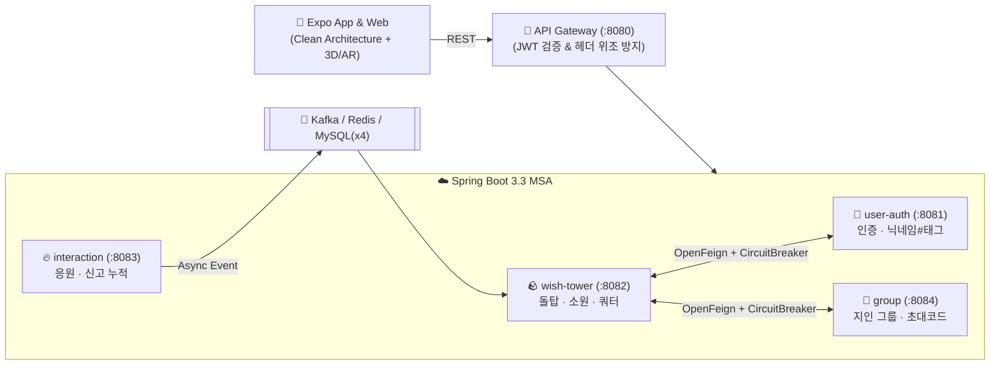

# 🪨 Wish Stone (위시 스톤)

> **"작은 돌 하나에 담긴 소원이 세상과 연결되는 공간"**  
> 디지털 돌을 쌓으며 소원을 기록하고, 타인의 소원을 익명으로 만나 **응원(🔥)**하며 함께 돌탑을 만들어가는 **3D · AR 소원 커뮤니티 (App & Web)**


---

## ✨ 핵심 기능 (v2 Production Release)

- **🌌 고요한 선(Zen)의 정원 맵 & 6-DoF 자유 카메라 네비게이션 (v2 R1)**
  - **넓은 선의 정원(반경 28m)**: 동양적인 카레산스이(枯山水) 동심원 물결 링 9겹, 자연 디딤돌 6개소, 짙은 밤하늘 톤(`#0F121A`)과 일치하는 지수 감쇠 안개(`fogExp2`) 및 은은한 반딧불 파티클(24개).
  - **무한 물리 바닥 정렬**: 3D 시각 바닥과 충돌 물리 평면이 완전 일치하여 돌이 바닥 밑으로 떨어지지 않는 평온함 유지.
  - **6-DoF 카메라 & 돌탑 복귀 HUD**: 부드러운 Pan(패닝), 핀치 줌(1.2m~24.0m)과 15m 실린더 바운더리 클램핑 지원. 정원을 멀리 둘러본 뒤에도 `[ 🎯 돌탑으로 복귀 ]` 원터치 버튼으로 언제든 탑 중심으로 부드럽게 복귀(Exponential Glide).
  - **제스처 완전 분리**: 돌 드래그 시 카메라 컨트롤이 안전하게 잠겨(Pointer Lock), 화면 이동과 돌 조작이 완벽히 분리되어 쾌적한 조작성 제공.

- **⚖️ 무게중심(CoG) 편심도 & 마이크로 워블 물리 엔진 고도화 (v2 R2)**
  - **2D 볼록 껍질(Convex Hull) 지지면 계산**: 앤드루 모노톤 체인 알고리즘 기반 지지 다각형 및 편심도 비율 $\eta = d_{\text{ecc}} / R_{\text{support}}$ 실시간 산출.
  - **3단계 물리 안정성 판정**: 안정($\eta < 0.40$), 아슬아슬($0.40 \le \eta \le 0.90$), 전복($\eta > 0.90$) 영역별 임계 전복 토크($\tau_{\text{crit}}$) 검증.
  - **감쇠 조화 진동 마이크로 워블**: 아슬아슬한 위치에 돌을 얹었을 때 부자연스럽게 얼어붙지 않고 현실적인 흔들림 감쇠 진동($\theta(t) = \theta_0 e^{-\zeta \omega_n t} \cos(\omega_d t)$) 연출.
  - **쿨롱 마찰 경사면 미끄러짐**: 지지면 기울기가 정지 마찰각($\approx 26.6^\circ$, $\mu_s \approx 0.50$)을 초과할 때 돌이 미끄러져 떨어지는 현실적인 물리 피드백.
  - **결정론적 PGS 시뮬레이터**: 60Hz 고정 시간 스텝 기반 100% 동일한 물리 궤적 재현성 보장.

- **🪨 자연스러운 강자갈(River Pebble) 모델링 & 무작위 리롤(Reroll) UI (v2 R3)**
  - **유기적 자갈 지오메트리**: 구면 조화 변형과 바닥 평탄화 고원($y = -H_y$)을 통해 각진 박스 형태를 완전히 탈피하고 돌끼리 겹침(Clipping) 없는 자연스러운 밀착 안착 실현.
  - **12종 천연 광물 색상 팔레트**: 강자갈의 질감에 어울리는 현무암, 청회석, 황토석, 강모래석 등 12가지 따뜻한 천연 톤 제공.
  - **돌 탐색 리롤 플로팅 버튼**: 돌 선택(`src/app/stack/stone.tsx`) 및 쌓기(`src/app/stack/place.tsx`) 화면에서 `[ 🎲 다른 돌 찾아보기 ]` 버튼을 눌러 탑 캔버스 깜빡임 없이 즉각 새로운 형태와 색상의 돌을 탐색 가능.

- **🕹️ 3D 인터랙티브 카메라 컨트롤 & 뷰포트 프리셋**
  - **360° 자유 회전 OrbitControls**: 돌 쌓기 도중 360° 회전을 통해 돌탑의 앞·뒤·측면 균형을 자유롭게 확인하며 안정적으로 안착시킬 수 있습니다.
  - **4대 카메라 시점 프리셋 HUD**: **정면(Front)**, **측면 45°(Side 45°)**, **탑뷰(Top-down, ~82° 짐벌락 방지)**, **360° 자유(Free)** 시점을 제공하며 지수 보간(Exponential LERP)으로 부드럽게 시점을 전환합니다.

- **🏛️ 전용 소원 돌탑 360° 탐색 페이지 (`/tower`)**
  - **전용 라우트 `/tower`**: 홈 화면(`src/app/home.tsx`) 및 루트 레이아웃(`src/app/_layout.tsx`)과 연동되어 360° 회전, 핀치 줌(Zoom), 팬(Pan)을 통해 완성된 돌탑을 감상할 수 있습니다.
  - **카테고리 필터 탭**: 전체, 취업, 학업, 건강, 관계, 기타 6종 카테고리 탭을 지원하며, 빠른 탭 전환 시 응답 역전 현상을 방지하는 비동기 요청 시퀀스 가드(`loadSeqRef`)를 탑재했습니다.

- **✨ 3D 돌 선택 하이라이트 & SCR-10 소원 상세 바텀시트**
  - **3D 토스 블루 하이라이트**: 돌탑 내 돌 클릭/터치 시 카메라 포커스 글라이드와 함께 **Toss Blue (`#0064FF`)** 발광(Emissive) 효과로 선택 상태를 직관적으로 피드백합니다.
  - **SCR-10 소원 상세 바텀시트**: 선택된 돌의 소원 본문, 개화(꽃/새싹/이끼) 뱃지, 작성자 정보(공개 돌탑 익명 vs 그룹 돌탑 닉네임#태그), 응원 현황(본인: 정확한 횟수 vs 타인: 빛 0~3단계)을 제공합니다.
  - **응원하기 연동 (`wishes.cheer`) & 동시성 보호**: 응원 버튼 터치 시 `wishes.cheer` 호출, 반딧불 파티클(`cheer_spark`) 발사, 빛 레벨 상승 및 감성 토스트를 발행합니다.

- **🤫 익명 돌탑 & 지인 그룹 돌탑**
  - **공개·카테고리 돌탑:** 작성자 정보를 완전히 숨겨 누구든 편하게 소원을 남깁니다.
  - **지인 그룹 돌탑:** 8자리 초대 코드로 모인 그룹원에게만 **`닉네임#태그`** (예: `제미나이#real`)가 보입니다.
- **🌸 소원 이루어짐 (개화 연출)**
  - 소원이 이루어지면 돌 위에 **꽃 · 새싹 · 이끼**가 피어나 돌탑에 희망을 더합니다.

---

## 🏗️ 아키텍처 한눈에 보기



- **Frontend:** `presentation(UI/Controller)` → `application(UseCase)` → `domain(Entity/Port)` ← `infrastructure(MSA API / 3-Way AR / Physics)`
- **Backend:** 서비스별 **4개 DB 분리(`user_db`, `wish_db`, `interaction_db`, `group_db`)** + **OpenFeign(서킷브레이커 폴백)** + **Kafka(비동기 멱등 컨슈머)**

---

## 📂 디렉토리 구조

```text
위시 스톤/
├─ src/                     # 📱 클라이언트 (Expo + TypeScript + Three.js)
│  ├─ app/                  # 화면 라우트 (SCR-01 ~ SCR-18, /home, /tower, /stack/*)
│  ├─ presentation/         # 화면 컨트롤러 및 3D/이펙트 컴포넌트 (StoneTowerCanvas, pebbleGeometrySpec 등)
│  ├─ application/          # 유스케이스 (돌 쌓기, 응원, 성취, 랜덤 탐색)
│  ├─ domain/               # 도메인 엔티티, 값 객체, 물리 안정성 평가기(StabilityEvaluator)
│  ├─ infrastructure/       # MSA 게이트웨이 어댑터, AR 3종 세션, PGS 물리 엔진(SimpleTowerPhysicsWorld)
│  └─ __tests__/            # 495개 단위 · 통합 · E2E · 적대적 스트레스 테스트 스위트
├─ backend/                 # ☁️ 백엔드 (Spring Boot 3.3 멀티모듈, 패키지 com.wishstone.*)
│  ├─ gateway-service/      # (:8080) API Gateway & JWT 보안 필터
│  ├─ user-auth-service/    # (:8081) 소셜·게스트 인증 및 닉네임#태그
│  ├─ wish-tower-service/   # (:8082) 돌탑 조회, 소원 생성, 자동 분류, 일일 쿼터
│  ├─ interaction-service/  # (:8083) 응원하기(1/5/15 빛 단계) 및 신고(5회 블라인드)
│  ├─ group-service/        # (:8084) 지인 그룹 생성·참여·권한 검증
│  ├─ common-events/        # Kafka 공유 이벤트 객체 (WishStoneEvents)
│  └─ docker-compose.yml    # MySQL 8.0 · Redis 7 · Kafka 원클릭 인프라
├─ scripts/                 # ⚙️ 유틸리티 및 서비스 기동 스크립트
│  ├─ start-backend.cjs     # 5개 MSA 서비스 일괄 기동 스크립트
│  ├─ run-backend.ps1       # PowerShell 백엔드 실행 스크립트
│  ├─ quickstart.bat        # 원클릭 실행 배치 스크립트
│  └─ benchmarks/           # 물리 엔진 정밀 벤치마크 스위트
└─ docs/                    # 📘 프로젝트 맥락, 의사결정, 설계 사양서 및 QA 문서
   ├─ spec/                 # PRD v1.0, 요구사항 정의서, 화면/API/데이터 모델/아키텍처/MSA 설계서
   ├─ PROJECT_CONTEXT.md    # 프로젝트 전체 맥락 및 핵심 도메인 규칙 요약
   ├─ TASKS.md              # 스프린트 진행 현황 및 495개 테스트 검증 내역
   ├─ DECISIONS.md          # 기술·기획 주요 의사결정 기록 (D-001 ~ D-026)
   └─ TEST_READY.md         # v2 E2E 및 적대적 검증 리포트
```

---

## 🚀 빠른 실행 (Quick Start)

### 1. 백엔드 MSA 5개 서비스 기동
```bash
# 빌드된 5개 Spring Boot JAR(:8080 ~ :8084) 일괄 기동
npm run backend:start
```

### 2. 프론트엔드 테스트 & 웹 서버 실행
```bash
# 전체 495개 테스트 스위트 및 타입 검사 실행
npm test
npm run typecheck

# Expo 웹 개발 서버 실행 (:8085)
npx expo start --web --port 8085
```

---

## 📚 문서 안내

| 문서 | 설명 |
| :--- | :--- |
| **[docs/PROJECT_CONTEXT.md](./docs/PROJECT_CONTEXT.md)** | 프로젝트 전체 맥락 및 핵심 도메인 규칙 요약 |
| **[docs/TASKS.md](./docs/TASKS.md)** | 스프린트 진행 현황 및 완료 백로그 (`495/495 PASS`) |
| **[docs/DECISIONS.md](./docs/DECISIONS.md)** | 기술·기획 주요 의사결정 기록 (`D-001 ~ D-026`) |
| **[docs/spec/](./docs/spec/)** | PRD, 요구사항 정의서(`DB-001~030`), 화면 설계서(`SCR-01~18`), API 명세서(`API-01~20`), 데이터 모델 |
| **[docs/TEST_READY.md](./docs/TEST_READY.md)** | v2 프로덕션 E2E 및 적대적 하드닝 검증 완료 보고서 |
