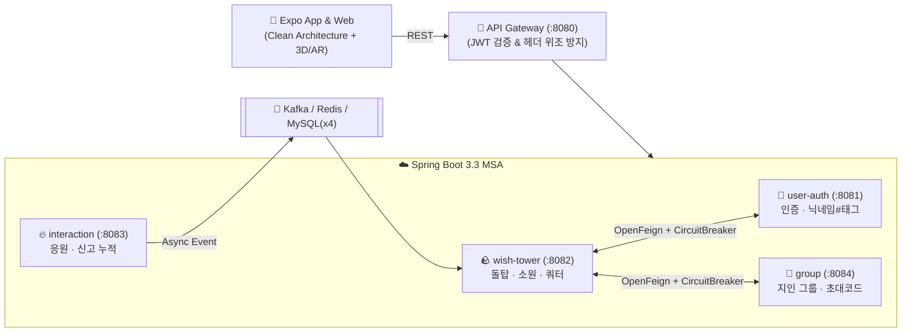

# 🪨 StoneWish (위시 스톤)

> **"작은 돌 하나에 담긴 소원이 세상과 연결되는 공간"**  
> 디지털 돌을 쌓으며 소원을 기록하고, 타인의 소원을 익명으로 만나 **응원(🔥)**하며 함께 돌탑을 만들어가는 **3D · AR 소원 커뮤니티 (App & Web)**


---

## ✨ 핵심 기능

- **🕹️ 3D 인터랙티브 카메라 컨트롤 & 뷰포트 프리셋 (R1)**
  - **360° 자유 회전 OrbitControls**: 돌 쌓기(`src/app/stack/place.tsx`) 도중 360° 회전을 통해 돌탑의 앞·뒤·측면 균형을 자유롭게 확인하며 안정적으로 안착시킬 수 있습니다.
  - **4대 카메라 시점 프리셋 HUD**: **정면(Front)**, **측면 45°(Side 45°)**, **탑뷰(Top-down, ~82° 짐벌락 방지)**, **360° 자유(Free)** 시점을 제공하며 지수 보간(Exponential LERP)으로 부드럽게 시점을 전환합니다.
  - **카메라 아이들 리셋 버그 해결**: 상호작용이 없는 유휴(Idle) 상태에서도 사용자가 설정한 시점과 각도가 유지되도록 카메라 상태 영속성을 보장합니다.

- **🏛️ 전용 소원 돌탑 360° 탐색 페이지 (`/tower`, R2)**
  - **전용 라우트 `/tower`**: 홈 화면(`src/app/home.tsx`) 및 루트 레이아웃(`src/app/_layout.tsx`)과 연동되어 360° 회전, 핀치 줌(Zoom), 팬(Pan)을 통해 완성된 돌탑을 감상할 수 있습니다.
  - **카테고리 필터 탭**: 전체, 취업, 학업, 건강, 관계, 기타 6종 카테고리 탭을 지원하며, 빠른 탭 전환 시 응답 역전 현상을 방지하는 비동기 요청 시퀀스 가드(`loadSeqRef`)를 탑재했습니다.

- **✨ 3D 돌 선택 하이라이트 & SCR-10 소원 상세 바텀시트 (R3)**
  - **3D 토스 블루 하이라이트**: 돌탑 내 돌 클릭/터치 시 **Toss Blue (`#0064FF`)** 발광(Emissive) 효과로 선택 상태를 직관적으로 피드백합니다.
  - **SCR-10 소원 상세 바텀시트**: 선택된 돌의 소원 본문, 개화(꽃/새싹/이끼) 뱃지, 작성자 정보(공개 돌탑 익명 vs 그룹 돌탑 닉네임#태그), 응원 현황(본인: 정확한 횟수 vs 타인: 빛 0~3단계)을 제공합니다.
  - **바텀시트 터치 격리**: 바텀시트 활성화 시 3D OrbitControls가 자동 비활성화되어 제스처 간섭을 원천 차단합니다.
  - **응원하기 연동 (`wishes.cheer`) & 동시성 보호**: 응원 버튼 터치 시 `wishes.cheer` 호출, 반딧불 파티클(`cheer_spark`) 발사, 빛 레벨 상승 및 감성 토스트를 발행합니다. 연타로 인한 중복 응원을 차단하는 동기화 락(`submittingRef`, `cheerInFlightRef`)을 적용했습니다.

- **🤫 익명 돌탑 & 지인 그룹 돌탑**
  - **공개·카테고리 돌탑:** 작성자 정보를 완전히 숨겨 누구든 편하게 소원을 남깁니다.
  - **지인 그룹 돌탑:** 8자리 초대 코드로 모인 그룹원에게만 **`닉네임#태그`** (예: `제미나이#real`)가 보입니다.
- **🪨 3D & AR 드래그 돌 쌓기**
  - 기기 환경에 맞춰 **네이티브 AR(Viro) · 웹 AR(WebXR) · 간이 AR(카메라 오버레이) · 일반 3D**로 자동 전환됩니다.
  - 소원 본문을 분석해 **카테고리(`취업`/`학업`/`건강`/`관계`/`기타`)를 자동 분류**하며, 돌이 빗나가면 돌탑이 무너지는 물리 연출(`tower_collapsed`)이 재생됩니다.
- **🔥 숫자 경쟁 없는 응원**
  - 댓글 대신 **응원 🔥**만 보낼 수 있습니다. 정확한 응원 수는 본인에게만 보이고, 타인에게는 **돌이 빛나는 단계(0~3단계)** 로만 표시됩니다.
- **🌸 소원 이루어짐 (개화 연출)**
  - 소원이 이루어지면 돌 위에 **꽃 · 새싹 · 이끼**가 피어나 돌탑에 희망을 더합니다.

---

## 🏗️ 아키텍처 한눈에 보기



- **Frontend:** `presentation(UI/Controller)` → `application(UseCase)` → `domain(Entity/Port)` ← `infrastructure(MSA API / 3-Way AR / Physics)`
- **Backend:** 서비스별 **4개 DB 분리(`user_db`, `wish_db`, `interaction_db`, `group_db`)** + **OpenFeign(서킷브레이커 폴백)** + **Kafka(비동기 멱등 컨슈머)**

---

## 📂 디렉토리 구조

```text
위시 스톤/
├─ src/                     # 📱 클라이언트 (Expo + TypeScript)
│  ├─ app/                  # 화면 라우트 (SCR-01 ~ SCR-18)
│  ├─ presentation/         # 화면 컨트롤러 및 3D/이펙트 컴포넌트
│  ├─ application/          # 유스케이스 (돌 쌓기, 응원, 성취, 랜덤 탐색)
│  ├─ domain/               # 도메인 엔티티, 값 객체(Nickname#Tag 등), 포트
│  └─ infrastructure/       # MSA 게이트웨이 어댑터, AR 3종 세션, 물리 엔진
├─ backend/                 # ☁️ 백엔드 (Spring Boot 3.3 멀티모듈)
│  ├─ gateway-service/      # (:8080) API Gateway & JWT 보안 필터
│  ├─ user-auth-service/    # (:8081) 소셜·게스트 인증 및 닉네임#태그
│  ├─ wish-tower-service/   # (:8082) 돌탑 조회, 소원 생성, 자동 분류, 일일 쿼터
│  ├─ interaction-service/  # (:8083) 응원하기(1/5/15 빛 단계) 및 신고(5회 블라인드)
│  ├─ group-service/        # (:8084) 지인 그룹 생성·참여·권한 검증
│  ├─ common-events/        # Kafka 공유 이벤트 객체
│  └─ docker-compose.yml    # MySQL 8.0 · Redis 7 · Kafka 원클릭 인프라
├─ dash_board/              # 📋 기획·설계 문서 (PRD, 요구사항, 화면/API/DB 설계서)
└─ docs/                    # 📘 협업 가이드, 백엔드 멘토링 문서, QA 리포트
```

---

## 🚀 빠른 실행 (Quick Start)

### 1. 인프라 실행 (MySQL · Redis · Kafka)
```bash
cd backend
docker compose up -d
```

### 2. 백엔드 빌드 & 테스트
```bash
cd backend
gradle test
```

### 3. 프론트엔드 테스트 & 앱 실행
```bash
# 도메인 · AR · 컨트롤러 전체 테스트
node --test src/__tests__/*.test.ts

# 개발 서버 실행
npm install
npx expo start
```

---

## 📚 문서 안내

| 문서 | 설명 |
| :--- | :--- |
| **[PROJECT_CONTEXT.md](./PROJECT_CONTEXT.md)** | 프로젝트 전체 맥락 및 핵심 도메인 규칙 요약 |
| **[TASKS.md](./TASKS.md)** | 스프린트 진행 현황 및 완료 백로그 |
| **[DECISIONS.md](./DECISIONS.md)** | 기술·기획 주요 의사결정 기록 (`D-001 ~ D-019`) |
| **[dash_board/](./dash_board/)** | PRD, 요구사항 정의서(`DB-001~030`), 화면 설계서(`SCR-01~18`), API 명세서(`API-01~20`), 데이터 모델 |
| **[docs/](./docs/)** | 협업 가이드, Spring Boot MSA 사수 멘토링 가이드, 테스트 체크리스트 |
