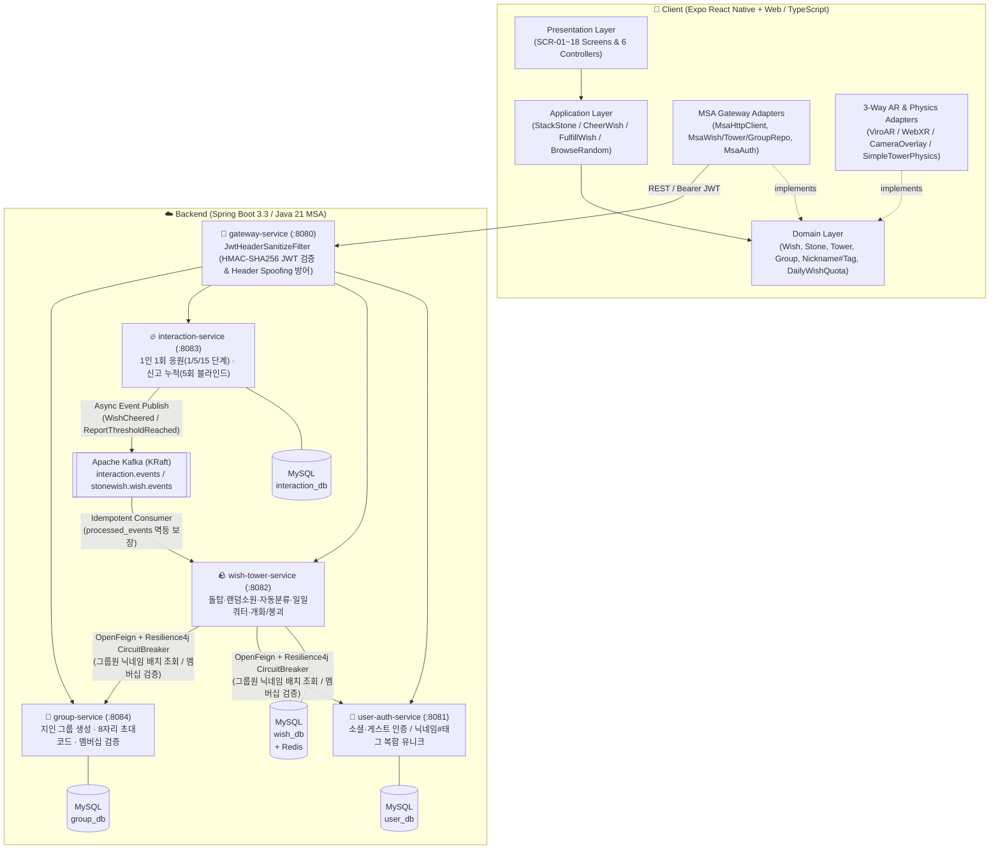

# 🪨 StoneWish (위시 스톤)

> **"작은 돌 하나에 담긴 소원이 세상과 연결되는 공간"**  
> 디지털 돌을 쌓으며 소원을 기록하고, 타인의 소원을 우연히 만나 **응원(🔥)**하며 함께 하나의 거대한 돌탑을 만들어가는 **3D · AR 감성 소원 커뮤니티 (Mobile & Web)**


---

## ✨ 1. 핵심 가치 & 주요 기능

기존 SNS의 과시와 '좋아요' 경쟁에서 벗어나, 현실에서 돌탑을 쌓으며 누군가의 행복을 기원하던 문화를 디지털·AR 공간으로 옮겨왔습니다.

| 핵심 가치 | 주요 기능 및 도메인 규칙 |
| :--- | :--- |
| **🤫 완전한 익명성 vs 지인 그룹** | • **공개·카테고리 돌탑 & 랜덤 소원 카드:** 작성자 식별 정보(`userId`, 닉네임)를 서버·도메인 양단에서 원천 마스킹하여 완전 익명 보장<br>• **지인 그룹 돌탑 (`group:{id}`):** 초대 코드(8자리)로 참여한 그룹원끼리만 **`닉네임#태그`** (예: `제미나이#real`, 미지정 시 4자리 난수 태그 자동 부여) 공개 |
| **🔥 비교 없는 공감 (응원 빛 단계)** | • 댓글·좋아요 경쟁 대신 텍스트 없는 **응원 🔥** 버튼만 제공 (1인 1소원 1회, 본인 소원 응원 불가)<br>• 정확한 응원 수는 **작성자 본인에게만** 보이며, 타인에게는 돌이 빛나는 **0~3단계(`1 / 5 / 15` 동적 임계치)** 로만 표현<br>• 응원 시 불꽃 파티클(`cheer_spark`)과 함께 작은 연출용 돌이 탑에 날아가 안착 |
| **🪨 3D & AR 드래그 돌 쌓기** | • 돌 모양(`round`, `flat`, `pebble`, `tall`)과 색상을 고르고 소원 작성 시 본문 키워드 기반으로 **카테고리(`취업`/`학업`/`건강`/`관계`/`기타`) 자동 분류** 및 사후 수정 지원<br>• **3중 AR 어댑터:** 네이티브(`ARKit`/`ARCore` ViroReact), 모바일 웹(`WebXR`), 미지원 브라우저(`Camera Overlay 간이 AR`) 및 일반 3D 모드 자동 폴백<br>• **물리 시뮬레이션 & 무너짐 연출:** 중심 반경을 벗어나 돌이 떨어지거나 소원을 삭제하면 돌탑이 와르르 무너지는 물리 연출(`tower_collapsed`) 재생, 3회 연속 실패 시 꼭대기 자동 안착 보정 |
| **🌸 희망의 개화 (소원 이루어짐)** | • 시간이 흘러 소원이 이루어졌을 때 **'소원 이루어짐'** 처리 시 돌 위에 **꽃(`flower`) · 새싹(`sprout`) · 이끼(`moss`)** 가 피어나는 영구 연출 |
| **🎁 일일 소원 쿼터 & 안전 장치** | • 도배 방지를 위한 **일일 기본 5개 무료 쿼터(`baseQuota = 5`)** + 리워드 광고/결제 보너스 쿼터(`bonusQuota`) 충전 구조<br>• 욕설·불법 스팸 금칙어 필터링 및 **누적 5회 신고 시 Kafka 이벤트 기반 자동 블라인드(`HIDDEN`)** 격리 |

---

## 🏗️ 2. 시스템 아키텍처 (Clean Architecture + Spring Boot MSA)

클라이언트는 **헥사고날(포트와 어댑터) 클린 아키텍처**로 설계되어 UI·플랫폼·백엔드 의존성을 도메인에서 완전히 분리했으며, 백엔드는 **Spring Cloud Gateway + 4개 마이크로서비스 + Database-per-Service + Kafka/Feign 하이브리드 통신** 구조를 따릅니다.



### 🔄 동기(OpenFeign) vs 비동기(Kafka) 설계 원칙
1. **즉시 일관성·응답이 필요한 작업 → `OpenFeign + Resilience4j Circuit Breaker`**
   - 그룹 돌탑(`group:{id}`) 조회 시 호출자의 **그룹원 멤버십 권한 검증** (`GroupMembershipFeignClient` — 장애 시 **Fail-Closed**로 `403 NOT_GROUP_MEMBER` 차단)
   - 그룹 돌탑 돌 목록 렌더링 시 작성자들의 **`닉네임#태그` 배치 조회** (`UserAuthFeignClient` — 장애 시 **Fail-Open**으로 `"익명의 그룹원"` 폴백 반환하여 3D 돌탑 렌더링 유지)
2. **최종 일관성으로 충분한 후속 작업 → `Apache Kafka + Idempotent Consumer`**
   - 응원 등록 시 응원 수 증가(`WishCheeredEvent`) 및 신고 5회 누적 시 자동 숨김(`WishReportThresholdReachedEvent`)은 비동기 이벤트로 발행하며, `wish_db.processed_events` 테이블로 중복 수신 멱등성을 보장합니다.

---

## 🛠️ 3. 기술 스택

### 📱 Frontend (`src/`)
| 구분 | 기술 스택 | 비고 |
| :--- | :--- | :--- |
| **Framework** | Expo SDK 52 (React Native 0.76) + `expo-router` + `react-native-web` | iOS · Android · Web 단일 코드베이스 (TypeScript 5.6) |
| **3D & Physics** | Three.js, React Three Fiber (`@react-three/fiber`), `@react-three/drei`, `cannon-es` | 탑 기준 로컬 `Pose(x, y, z, quaternion)` 영속화 |
| **AR Engine** | `@reactvision/react-viro` (Native), `@react-three/xr` (WebXR), `expo-camera` (Overlay) | `ARSessionFactory`가 기기 역량에 맞춰 자동 선택 |
| **State & Test** | Clean Architecture Controllers, Node.js Built-in Test Runner (`node --test`) | 외부 런타임 의존성 없이 도메인·컨트롤러·E2E 테스트 고속 검증 |

### ⚙️ Backend (`backend/`)
| 구분 | 기술 스택 | 비고 |
| :--- | :--- | :--- |
| **Language & Framework** | Java 21 (Record 활용), Spring Boot 3.3.5, Spring Cloud 2023.0.3 | Gradle (Kotlin DSL) 멀티모듈 (6개 서브프로젝트) |
| **API Gateway** | Spring Cloud Gateway (WebFlux/Netty `:8080`) | 외부 `X-User-*` 헤더 강제 Strip + HMAC-SHA256 JWT 검증 |
| **Resilience & IPC** | Spring Cloud OpenFeign, Resilience4j CircuitBreaker, Spring Kafka | 동기 배치 조회 폴백 + 비동기 이벤트 드리븐 |
| **Database & Cache** | MySQL 8.0 (`user_db`, `wish_db`, `interaction_db`, `group_db`), Redis 7 | 서비스별 물리적 외래키(FK) 제거 (Database-per-Service) |
| **Test** | JUnit 5, Spring Boot Test (`@WebMvcTest`, Jackson Serialization) | 도메인·서비스·컨트롤러·서킷브레이커·계약 직렬화 테스트 |

---

## 📂 4. 프로젝트 폴더 구조

```text
위시 스톤/
├─ README.md                       # 프로젝트 소개 및 실행 가이드
├─ PROJECT_CONTEXT.md              # 전체 맥락 및 아키텍처 요약
├─ TASKS.md                        # 스프린트 진행 내역 및 백로그
├─ DECISIONS.md                    # 아키텍처·기획 의사결정 기록 (ADR: D-001 ~ D-019)
├─ dash_board/                     # 📋 상세 기획·설계 문서
│  ├─ PRD v1.0.md                  # 서비스 비전, 타겟 유저, MVP 범위, KPI
│  ├─ 요구 사항 정의서.md            # 기능·비기능 요구사항 30개 (DB-001 ~ DB-030)
│  ├─ 화면 설계서.md                 # 전체 화면 흐름 및 와이어프레임 (SCR-01 ~ SCR-18)
│  ├─ API 명세서.md                 # Gateway REST API (API-01 ~ API-20), Feign, Kafka 명세
│  ├─ 데이터 모델.md                 # 4개 분리 DB 스키마 및 Redis 키 구조
│  ├─ 아키텍처 설계.md               # 클라이언트 헥사고날 계층 및 클래스 설계
│  └─ 기술 스택.md                  # 기술 선정 근거 및 리스크 대응 방안
├─ src/                            # 📱 클라이언트 (Expo + TypeScript Clean Architecture)
│  ├─ domain/                      # 엔티티(Wish, Stone, Tower, Group), 값 객체(Nickname, Pose, CheerLevel, DailyWishQuota 등), 포트
│  ├─ application/                 # 유스케이스(StackStone, CheerWish, FulfillWish, BrowseRandomWishes)
│  ├─ infrastructure/              # MSA Gateway HTTP 어댑터, AR 3종 세션 어댑터(Viro/WebXR/Overlay), 물리 엔진
│  ├─ presentation/controllers/    # 화면 컨트롤러(Onboarding, Dashboard, StackStone, ExploreWishes, MyWishes, Group, Settings)
│  ├─ app/                         # expo-router 기반 전체 화면 라우트 (SCR-01 ~ SCR-18)
│  └─ __tests__/                   # 프론트엔드 도메인·AR·컨트롤러 통합 테스트 스위트
└─ backend/                        # ☁️ 백엔드 (Spring Boot 3.3 MSA 멀티모듈)
   ├─ docker-compose.yml           # MySQL 8.0 + Redis 7 + Apache Kafka (KRaft) 원클릭 구동
   ├─ sql/init-databases.sql       # 4개 마이크로서비스 전용 스키마 초기화 SQL
   ├─ common-events/               # Kafka 공유 이벤트 Record (WishCheered, WishReportThresholdReached 등)
   ├─ gateway-service/             # (:8080) 라우팅 및 JwtHeaderSanitizeFilter
   ├─ user-auth-service/           # (:8081) 로그인, 게스트→소셜 연동, 닉네임#태그 관리 및 배치 조회
   ├─ wish-tower-service/          # (:8082) 돌탑 조회, 소원 생성, 자동 카테고리 분류, 일일 쿼터, 개화/삭제 붕괴
   ├─ interaction-service/         # (:8083) 응원하기(1/5/15 빛 단계), 신고하기(5회 누적 자동 블라인드)
   └─ group-service/               # (:8084) 지인 그룹 생성, 초대 코드 참여, 멤버십 조회
```

---

## 🚀 5. 시작하기 (Quick Start)

### 1) 로컬 인프라 구동 (MySQL 8.0 · Redis 7 · Kafka KRaft)
```bash
cd backend
docker compose up -d
```
- 컨테이너 기동 시 `backend/sql/init-databases.sql`이 자동 실행되어 `user_db`, `wish_db`, `interaction_db`, `group_db` 4개 데이터베이스와 테이블이 생성됩니다.

### 2) 백엔드 빌드 및 단위·슬라이스 테스트 실행
```bash
cd backend
gradle test
```

### 3) 프론트엔드 도메인·AR·컨트롤러 테스트 및 앱 실행
```bash
# Node.js 내장 테스트 러너로 전체 도메인·AR·화면 컨트롤러(SCR-01~18) 즉시 검증
node --test src/__tests__/*.test.ts

# 패키지 설치 및 Expo 개발 서버 실행
npm install
npx expo start
```

---

## 🖥️ 6. 화면(`SCR-01 ~ SCR-18`) 및 API(`API-01 ~ API-20`) 요약

### 📱 클라이언트 화면 구성 (`src/app/`)
| 화면 ID | 경로 (`expo-router`) | 설명 |
| :--- | :--- | :--- |
| **SCR-01 ~ 03** | `/`, `/login`, `/onboarding/nickname` | 자동 로그인 체크, 4종 로그인(Kakao/Apple/Google/Guest), `닉네임#태그` 실시간 검증·설정 |
| **SCR-04** | `/home` | 메인 대시보드 — 돌탑 전환(`전체`/`카테고리`/`그룹`), 통계 바, 3D 돌탑 캔버스, 랜덤 소원 프리뷰 |
| **SCR-05 ~ 09** | `/stack/stone`, `/write`, `/place`, `/ar`, `/photo` | 돌 모양·색상 선택 → 소원 작성(자동 카테고리 프리뷰 & 일일 쿼터 확인) → 3D/AR 드래그 쌓기 및 사진 촬영 |
| **SCR-10 ~ 11** | `/explore` | 타인 소원 카드 스와이프 탐색, 익명 응원(`🔥` 불꽃 연출), 부적절 소원 사유별 신고 바텀시트 |
| **SCR-12 ~ 14** | `/me/wishes` | 내 소원 목록(응원 수 확인), 카테고리 사후 변경, 소원 이루어짐 개화 연출 선택(꽃/새싹/이끼), 소원 삭제 |
| **SCR-15 ~ 16** | `/groups` | 내 지인 그룹 목록, 그룹 생성(8자리 초대 코드 발급), 초대 코드로 참여, 게스트 소셜 연동 안내 |
| **SCR-17 ~ 18** | `/settings` | 프로필 `닉네임#태그` 변경, 오늘의 소원 쿼터 현황 및 리워드 충전, 게스트 소셜 계정 연동·회원 탈퇴 모달 |

### 🔌 API Gateway (`:8080`) 주요 엔드포인트
| 분류 | 메서드 및 경로 | 담당 서비스 | 설명 |
| :--- | :--- | :--- | :--- |
| **인증·계정** | `POST /api/v1/auth/login`<br>`POST /api/v1/auth/link`<br>`PUT /api/v1/users/me/nickname`<br>`GET / DELETE /api/v1/users/me` | `user-auth` (`:8081`) | 소셜·게스트 로그인, 게스트→소셜 계정 연동(데이터 보존), `닉네임#태그` 설정·변경, 내 프로필 조회 및 회원 탈퇴 |
| **돌탑·소원** | `GET /api/v1/towers/{towerKey}`<br>`GET /api/v1/towers/{towerKey}/stats`<br>`POST /api/v1/wishes`<br>`GET /api/v1/wishes/random`<br>`GET /api/v1/wishes/me` | `wish-tower` (`:8082`) | 돌탑 조회(공개 익명 / 그룹 멤버십 검증 및 닉네임#태그 주입), 통계 조회, 소원 생성(자동 분류·쿼터 차감), 익명 랜덤 소원 카드 풀, 내 소원 목록 |
| **생명주기·쿼터** | `PATCH /api/v1/wishes/{id}/fulfill`<br>`DELETE /api/v1/wishes/{id}`<br>`PATCH /api/v1/wishes/{id}/category`<br>`POST /api/v1/wishes/quota/reward` | `wish-tower` (`:8082`) | 소원 이루어짐 개화 처리, 소원 삭제(`tower_collapsed` 메타데이터 반환), 카테고리 사후 수정, 리워드 보너스 쿼터 충전 |
| **응원·신고** | `POST /api/v1/wishes/{id}/cheers`<br>`POST /api/v1/wishes/{id}/reports` | `interaction` (`:8083`) | 1인 1회 익명 응원(빛 단계 상승 응답 + Kafka 발행), 사유별 신고(5회 도달 시 자동 블라인드 이벤트 발행) |
| **지인 그룹** | `POST /api/v1/groups`<br>`POST /api/v1/groups/join`<br>`GET /api/v1/groups/me`<br>`DELETE /api/v1/groups/{id}/members/me` | `group` (`:8084`) | 그룹 생성(게스트 차단, 8자리 초대 코드), 초대 코드 참여(정원 50명 검증), 내 그룹 목록, 그룹 나가기 |

---

## 📚 7. 설계 문서 바로가기

프로젝트의 모든 요구사항과 아키텍처 결정 과정은 아래 문서에 체계적으로 기록되어 있습니다.

- 🧭 **[PROJECT_CONTEXT.md](./PROJECT_CONTEXT.md)** — 프로젝트 전체 맥락 및 도메인 핵심 규칙 요약
- ✅ **[TASKS.md](./TASKS.md)** — 스프린트별 완료 내역 및 확정된 기획 정책표
- ⚖️ **[DECISIONS.md](./DECISIONS.md)** — `D-001`(AR MVP 포함)부터 `D-019`(돌탑 무너짐 연출)까지의 모든 아키텍처·기획 결정 기록(ADR)
- 📋 **[dash_board/PRD v1.0.md](./dash_board/PRD%20v1.0.md)** — 제품 요구사항 정의서 (PRD)
- 📑 **[dash_board/요구 사항 정의서.md](./dash_board/%EC%9A%94%EA%B5%AC%20%EC%82%AC%ED%95%AD%20%EC%A0%95%EC%9D%98%EC%84%9C.md)** — 기능·비기능 상세 요구사항 (`DB-001 ~ DB-030`)
- 🖼️ **[dash_board/화면 설계서.md](./dash_board/%ED%99%94%EB%A9%B4%20%EC%84%A4%EA%B3%84%EC%84%9C.md)** — 화면 흐름도 및 와이어프레임 (`SCR-01 ~ SCR-18`)
- 🔗 **[dash_board/API 명세서.md](./dash_board/API%20%EB%AA%85%EC%84%B8%EC%84%9C.md)** — 외부 REST API, 내부 OpenFeign API, Kafka 이벤트 명세
- 🗄️ **[dash_board/데이터 모델.md](./dash_board/%EB%8D%B0%EC%9D%B4%ED%84%B0%20%EB%AA%A8%EB%8D%B8.md)** — Database-per-Service ERD 및 Redis 데이터 구조
- 🏛️ **[dash_board/아키텍처 설계.md](./dash_board/%EC%95%84%ED%82%A4%ED%85%8D%EC%B2%98%20%EC%84%A4%EA%B3%84.md)** — 클라이언트 클린 아키텍처 및 AR 3중 어댑터 설계
- 🎓 **[BACKEND_SENIOR_MENTOR_GUIDE.md](./BACKEND_SENIOR_MENTOR_GUIDE.md)** — Spring Boot MSA 실무 아키텍처 & 사수 멘토링 가이드
