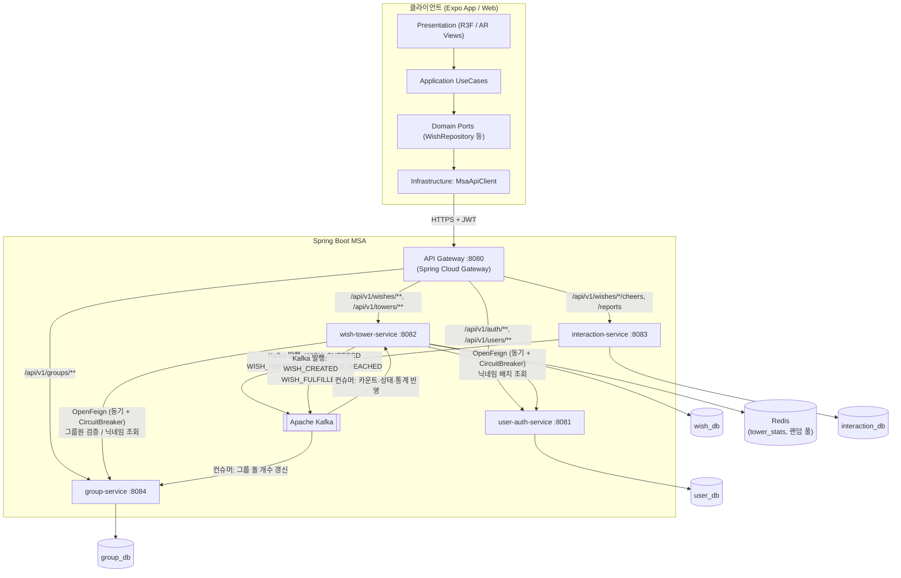
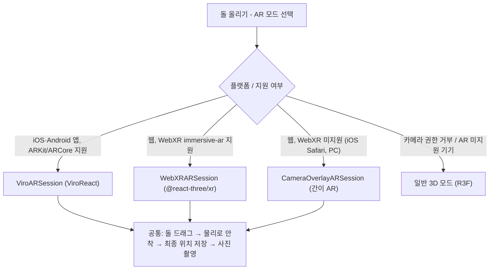

# 기술 스택 결정서

> 근거: [[요구 사항 정의서]] DB-026~029, [[MSA]] / 조건: 모바일(iOS·Android) + 웹, AR 포함, 백엔드 Spring Boot MSA 학습 및 구축

## 1. 결정 요약

| 영역 | 선택 | 비고 |
| --- | --- | --- |
| 앱 프레임워크 | Expo (React Native) + expo-router | 앱·웹 단일 코드베이스 |
| 웹 | react-native-web (Expo Web) | expo-router로 라우팅 공유 |
| 클라이언트 언어 | TypeScript | |
| 3D 렌더링 (일반 모드) | Three.js + React Three Fiber (`@react-three/fiber`, 네이티브는 `/native`) + drei | 모바일·웹 공용 |
| 물리 (일반 모드) | cannon-es | 순수 JS라 RN·웹 모두 동작 |
| 모바일 AR | ViroReact (`@reactvision/react-viro`) | ARKit / ARCore, 자체 물리·스크린샷 기능 내장 |
| 웹 AR | WebXR + `@react-three/xr` (hit-test) | Android Chrome 등 |
| 웹 AR 대체 | 카메라 영상(getUserMedia) 위에 R3F 캔버스를 겹치는 간이 AR | iOS Safari, PC |
| 3D 에셋 | glTF(.glb) 돌 모델 공용 | Viro·Three.js 둘 다 glb 로드 가능 |
| 상태 관리 | Zustand (클라이언트) + TanStack Query (서버) | |
| API 게이트웨이 | **Spring Cloud Gateway** (Port 8080) | 단일 진입점, JWT 검증 및 `X-User-Id` 헤더 주입, 라우팅 |
| 백엔드 마이크로서비스 | **Spring Boot 3.x (Java 21) + Spring Data JPA** | `user-auth` (8081), `wish-tower` (8082), `interaction` (8083), `group` (8084) |
| 서비스 간 동기 통신 | **Spring Cloud OpenFeign + Resilience4j (Circuit Breaker)** | 그룹원 권한 확인, 그룹 내 닉네임 일괄 조회 (즉시 응답이 필요한 경우) |
| 서비스 간 비동기 통신 | **Apache Kafka (KRaft 모드)** | 응원(`WISH_CHEERED`), 신고 누적(`WISH_REPORT_THRESHOLD_REACHED`), 돌탑 통계 갱신 |
| 데이터베이스 | **MySQL 8.0 (Database per Service)** | `user_db`, `wish_db`, `interaction_db`, `group_db` 논리/물리 분리 |
| 캐시·랜덤 샘플링 | **Redis** | 돌탑 통계(`tower_stats`), 랜덤 소원 ID 풀(Set `SRANDMEMBER`), 레이트 리밋 |
| 인증 | **OAuth2 (Apple / Kakao / Google) + 게스트 토큰 + JWT** | `user-auth-service`에서 발급, 게스트 → 소셜 계정 연결(`link`) 지원 |
| 인프라·배포 | **Docker Compose** (로컬/개발), EAS Build (앱), Vercel (웹) | |
| 모니터링 | Sentry + Spring Boot Actuator | |

## 2. 왜 이 조합인가

- **프론트엔드 (Expo + R3F + AR 3중 어댑터):**
  - Unity WebGL과 Flutter Web은 웹 AR을 사실상 지원하지 않는다. Expo + R3F를 쓰면 일반 3D 돌탑 화면, 애니메이션, 응원 파티클을 앱과 웹에서 같은 코드로 그릴 수 있다.
  - AR은 플랫폼 차이를 피할 수 없으므로 `ARSession` 인터페이스를 하나로 정의하고 구현체 3개(Viro / WebXR / 간이 AR)를 둔다.
- **백엔드 (Spring Boot MSA + Kafka + Redis):**
  - [[MSA]] 문서의 핵심 학습 목표(**Gateway + REST/OpenFeign + JWT + Kafka 이벤트 + Circuit Breaker + DB 분리 + Docker**)를 StoneWish 도메인에 그대로 적용한다.
  - **즉시 결과가 필요한 요청**(예: 그룹 돌탑 조회 시 그룹원 여부 확인·닉네임 조회)은 **OpenFeign + Resilience4j Circuit Breaker**로 호출한다.
  - **최종 일관성(Eventual Consistency)으로 충분한 작업**(예: 응원 클릭 시 카운트 반영, 신고 5회 누적 시 소원 숨김, 돌탑 통계 갱신)은 **Kafka 이벤트**로 비동기 처리해 서비스 간 결합도를 낮춘다.

## 3. 전체 아키텍처 (클라이언트 ↔ MSA 백엔드)

## 4. AR 구현 구조

## 5. 리스크와 대응

| 리스크 | 영향 | 대응 |
| --- | --- | --- |
| MSA 서비스 장애 전파 (예: `user-auth-service` 다운 시 그룹 돌탑 조회 실패) | 가용성 저하 | OpenFeign에 **Resilience4j Circuit Breaker** 적용 → 장애 시 닉네임을 `"익명의 그룹원"`으로 폴백 반환 |
| Kafka 이벤트 중복 수신 | 응원 카운트 중복 증가 | 이벤트에 `eventId` 포함 + 컨슈머 멱등성(Idempotency) 처리 |
| ViroReact는 Expo Go에서 실행되지 않음 | 개발 편의성 저하 | EAS Development Build 사용 |
| iOS Safari에 WebXR 없음 | 웹 iOS 사용자는 바닥 인식 AR 불가 | 간이 AR로 대체하고 앱 설치 유도 |
| 앱(Viro 물리)과 웹(cannon-es 물리)의 결과 차이 | 같은 돌탑이 다르게 보일 수 있음 | 물리는 "쌓는 순간"에만 쓰고, 결과 위치(pose)를 저장해 모든 환경에서 같은 pose로 렌더링 |
