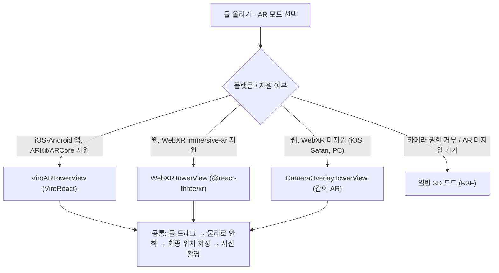

# 기술 스택 결정서

> 근거: [[요구 사항 정의서]] DB-026~029 / 조건: 모바일(iOS·Android) + 웹, AR 포함, 1인~소규모 팀 개발

## 1. 결정 요약

| 영역 | 선택 | 비고 |
| --- | --- | --- |
| 앱 프레임워크 | Expo (React Native) + expo-router | 앱·웹 단일 코드베이스 |
| 웹 | react-native-web (Expo Web) | expo-router로 라우팅 공유 |
| 언어 | TypeScript | |
| 3D 렌더링 (일반 모드) | Three.js + React Three Fiber (`@react-three/fiber`, 네이티브는 `/native`) + drei | 모바일·웹 공용 |
| 물리 (일반 모드) | cannon-es | 순수 JS라 RN·웹 모두 동작 |
| 모바일 AR | ViroReact (`@reactvision/react-viro`) | ARKit / ARCore, 자체 물리·스크린샷 기능 내장 |
| 웹 AR | WebXR + `@react-three/xr` (hit-test) | Android Chrome 등 |
| 웹 AR 대체 | 카메라 영상(getUserMedia) 위에 R3F 캔버스를 겹치는 간이 AR | iOS Safari, PC |
| 3D 에셋 | glTF(.glb) 돌 모델 공용 | Viro·Three.js 둘 다 glb 로드 가능 |
| 상태 관리 | Zustand (클라이언트) + TanStack Query (서버) | |
| 백엔드 | Supabase (Postgres + Auth + RLS + RPC + Edge Functions) | 별도 서버 없이 시작 |
| 인증 | Supabase Auth: Apple / Kakao / Google OAuth + 게스트(Anonymous Sign-in) | 게스트는 `linkIdentity`로 소셜 계정 연결 시 데이터 유지 (확정) |
| 캐시·랜덤 노출 | Postgres 함수로 시작, 트래픽이 늘면 Redis(Upstash) 도입 | |
| 빌드·배포 | EAS Build / EAS Submit, 웹은 Vercel 또는 Netlify | |
| 모니터링 | Sentry | |

## 2. 왜 이 조합인가

- **Unity / Flutter를 고르지 않은 이유:** Unity WebGL과 Flutter Web은 웹 AR을 사실상 지원하지 않는다. 웹을 따로 만들면 개발 비용이 2배가 된다.
- **Expo + R3F:** 일반 3D 돌탑 화면, 애니메이션, 응원 파티클을 앱과 웹에서 같은 코드로 그릴 수 있다.
- **AR만 플랫폼별 구현:** AR은 어떤 스택을 써도 플랫폼 차이를 피할 수 없다. 그래서 `ARTowerView` 인터페이스를 하나로 정의하고 구현체 3개(Viro / WebXR / 간이 AR)를 둔다.
- **Supabase:** 소원·응원·신고는 관계형 데이터이고 익명성 규칙을 RLS로 강제하기 좋다. 응원 카운트 증가는 RPC로 원자적으로 처리한다.

## 3. AR 구현 구조

| 구현체 | 바닥 인식 | 드래그 쌓기 | 사진 촬영 |
| --- | --- | --- | --- |
| ViroReact | O (plane detection) | O (Viro 물리) | `takeScreenshot` |
| WebXR | O (hit-test) | O (cannon-es) | XR 세션 중 캡처는 제약이 있음. 캡처 버튼을 누르면 세션을 잠시 멈추고 렌더 타깃을 저장 |
| 간이 AR | X (화면 고정 위치) | O (cannon-es, 2.5D) | video 프레임 + 캔버스를 합성해 저장 |

## 4. 리스크와 대응

| 리스크 | 영향 | 대응 |
| --- | --- | --- |
| ViroReact는 Expo Go에서 실행되지 않음 | 개발 편의성 저하 | EAS Development Build 사용 |
| ViroReact 유지보수 지속성 | 장기 리스크 | AR을 인터페이스 뒤로 분리해서, 필요하면 네이티브 모듈(ARKit/ARCore 직접 연동)로 교체 |
| iOS Safari에 WebXR 없음 | 웹 iOS 사용자는 진짜 AR 불가 | 간이 AR로 대체하고, 앱 설치를 유도 |
| 앱(Viro 물리)과 웹(cannon-es 물리)의 결과 차이 | 같은 돌탑이 다르게 보일 수 있음 | 물리는 "쌓는 순간"에만 쓰고, 결과 위치(pose)를 저장해 모든 환경에서 같은 pose로 렌더링 |
| 돌 수가 많을 때 렌더링 성능 | 프레임 저하 | 최근 N개(기본 200개)만 개별 렌더링하고 아래쪽은 instancing / 합쳐진 메시로 표시 |

## 5. 착수 전 PoC 권장 항목

1. Expo Dev Build에서 ViroReact로 바닥 인식 → glb 돌 드래그 → 물리 안착 → 스크린샷
2. Android Chrome에서 `@react-three/xr`로 hit-test 배치 + 캡처
3. iOS Safari 간이 AR(카메라 + R3F 오버레이) 프레임 성능
4. 돌 500개 instancing 렌더링 시 저사양 Android 프레임 측정

