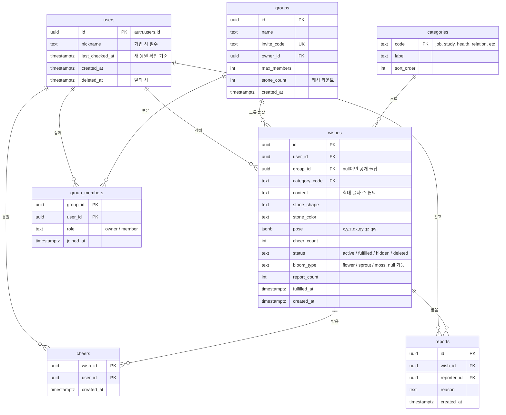

# 데이터 모델 (ERD)

> 근거: [[요구 사항 정의서]] / DB: Supabase(Postgres)
> 원칙: 응원은 카운트만 저장한다(DB-024). 연출용 돌은 저장하지 않는다.

## 1. ERD

## 2. 돌탑 개념

돌탑은 별도 테이블 없이 **소원을 어떻게 필터링하느냐**로 정의한다.

| 돌탑 | 조건 | 작성자 표시 |
| --- | --- | --- |
| 전체 돌탑 | `group_id IS NULL` | 익명 |
| 카테고리 돌탑 | `group_id IS NULL AND category_code = ?` | 익명 |
| 그룹 돌탑 | `group_id = ?` (그룹원만 조회 가능) | 닉네임 |

전체·카테고리 돌탑의 통계(총 돌 수, 오늘 돌 수, 이루어진 소원 수, 누적 응원 수)는 `tower_stats` 집계 테이블에 캐시한다.

| 컬럼 | 타입 | 설명 |
| --- | --- | --- |
| tower_key | text PK | `global`, `cat:job`, `group:{uuid}` |
| stone_count | bigint | |
| today_count | int | 매일 0시 초기화(cron) |
| fulfilled_count | bigint | |
| cheer_count | bigint | |
| updated_at | timestamptz | |

## 3. 주요 규칙과 제약

- **응원 중복 방지:** `cheers`의 PK가 `(wish_id, user_id)`다. 응원 텍스트는 없고, 행 하나는 약 40바이트다.
  - 용량이 문제가 되면 `fulfilled` / `deleted` 상태가 된 지 90일이 지난 소원의 `cheers` 행을 지운다(카운트는 `wishes.cheer_count`에 남음).
- **자기 소원 응원 금지:** RPC에서 `wishes.user_id <> auth.uid()`를 검사한다.
- **신고:** `reports`에 `(wish_id, reporter_id)` UNIQUE를 건다. `report_count`가 기준값(협의, 예: 5)에 도달하면 `status = 'hidden'`으로 바꾼다.
- **신고한 사용자에게 숨기기:** 랜덤 조회 시 본인이 신고한 소원을 제외한다.
- **삭제:** soft delete(`status = 'deleted'`)로 처리하고, 돌탑 렌더링에서는 뺀다. 돌탑에서 돌을 실제로 빼서 보여줄지는 협의 사항이다.
- **이루어짐:** `status = 'fulfilled'`, `bloom_type`은 사용자 선택 또는 랜덤, `fulfilled_at = now()`.
- **pose:** 쌓는 순간 물리로 안착된 최종 위치다. 모든 환경에서 같은 pose로 렌더링한다. AR로 쌓은 돌은 탑 기준 로컬 좌표로 변환해 저장한다.
- **랜덤 노출 중복 방지:** 최근 본 소원 ID는 클라이언트에 저장하고(최근 100개), 요청할 때 `exclude_ids`로 보낸다. 서버에는 저장하지 않는다.

## 4. RLS(행 수준 보안) 정책 요약

| 테이블 | SELECT | INSERT | UPDATE / DELETE |
| --- | --- | --- | --- |
| users | 본인만 (닉네임은 그룹 조회 RPC로만 노출) | 본인 | 본인 |
| wishes | 공개 소원은 `user_id`를 뺀 뷰(`public_wishes`)로만 조회, 그룹 소원은 그룹원만 | 본인 | 본인(내용 수정 불가, 상태 변경·삭제만) |
| cheers | 본인 응원 여부만 | RPC로만 | 불가 |
| reports | 불가 | RPC로만 | 불가 |
| groups / group_members | 그룹원만 | RPC(생성·참여) | owner만 |

> [!IMPORTANT]
> 공개 소원을 조회할 때 `user_id`를 클라이언트에 절대 내려주지 않는다(DB-023). `public_wishes` 뷰에서는 `user_id` 대신 `is_mine` boolean만 제공한다.
