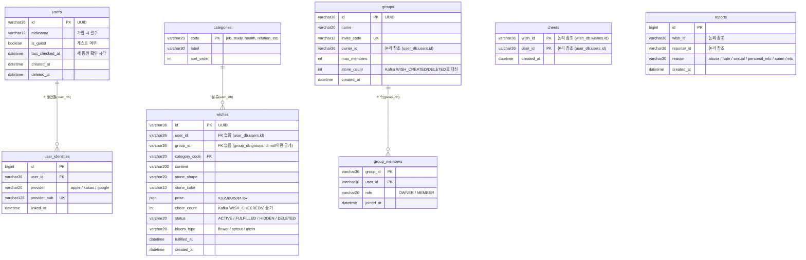

# 데이터 모델 (MSA Database-per-Service)

> 근거: [[요구 사항 정의서]], [[기술 스택]], [[MSA]]
> 원칙:
> 1. **서비스별 DB 분리(Database per Service):** 서비스 간 테이블 직접 조인(JOIN)이나 외래키(FK)를 두지 않는다. 다른 서비스의 데이터는 ID 값만 저장한다.
> 2. **데이터 경량화(DB-024):** 응원은 텍스트나 연출용 돌을 저장하지 않고 `interaction_db`의 중복 방지 레코드와 `wish_db`의 `cheer_count`만 유지한다.

## 1. 서비스별 DB 경계

| 서비스 | 데이터베이스 | 보유 테이블 / 키 | 역할 |
| --- | --- | --- | --- |
| `user-auth-service` (:8081) | `user_db` (MySQL) | `users`, `user_identities` | 회원·게스트 계정, 소셜 연동(`link`), 닉네임 관리 |
| `wish-tower-service` (:8082) | `wish_db` (MySQL) + `Redis` | `wishes`, `categories`, `processed_events` / Redis `tower_stats:*`, `random_pool:*` | 소원(돌) 생명주기, 3D pose, 돌탑 조회, 랜덤 소원 샘플링 |
| `interaction-service` (:8083) | `interaction_db` (MySQL) | `cheers`, `reports` | 응원 1인 1회 중복 방지, 신고 누적 카운트 및 Kafka 이벤트 발행 |
| `group-service` (:8084) | `group_db` (MySQL) | `groups`, `group_members` | 지인 그룹 생성, 초대 코드 발급·참여, 그룹원 권한 검증 |

---

## 2. 서비스별 ERD

---

## 3. Redis 데이터 구조 (`wish-tower-service` 관리)

| 키 패턴 | 자료구조 | 설명 |
| --- | --- | --- |
| `tower:stats:{towerKey}` | `Hash` (`stoneCount`, `todayCount`, `fulfilledCount`, `cheerCount`) | 대시보드 상단 통계 바(DB-006) 초고속 조회. Kafka 이벤트 수신 시 `HINCRBY`로 갱신 |
| `wish:random:pool` | `Set` (`wishId` 목록) | 공개 활성 소원 ID 모음. `SRANDMEMBER wish:random:pool 15`로 O(1) 랜덤 샘플링 후 클라이언트가 보낸 `excludeIds`를 빼고 5개 반환 |
| `ratelimit:{userId}:{action}` | `String` (TTL) | 소원 등록(하루 10회), 응원(분당 30회), 신고(하루 20회) 제한 |

---

## 4. 서비스 간 데이터 일관성 및 익명성 규칙

1. **익명성 강제 (DB-023, D-008):**
   - `wish-tower-service`의公开 API(`GET /api/v1/towers/global`, `GET /api/v1/towers/cat:*`, `GET /api/v1/wishes/random`) 응답 DTO에는 **`userId` 필드가 아예 존재하지 않으며**, 요청 헤더의 `X-User-Id`와 비교해 계산한 `isMine: boolean`만 내려준다.
   - 그룹 돌탑(`GET /api/v1/towers/group:{groupId}`)일 때만 `user-auth-service`의 내부 Feign API(`POST /internal/users/nicknames`)를 호출해 `nickname`을 채워 내려준다.
2. **응원 단계 공개 (DB-017, D-006):**
   - 타인 소원 조회 시 `cheerCount` 원시 숫자를 숨기고 `cheerLevel` (`0`: 0~9, `1`: 10~49, `2`: 50~99, `3`: 100+)만 반환한다.
   - 내 소원 목록(`GET /api/v1/wishes/me`)에서만 정확한 `cheerCount`를 반환한다.
3. **Kafka 비동기 정합성 (Eventual Consistency):**
   - 사용자가 응원을 누르면 `interaction-service`가 `(wish_id, user_id)` PK로 중복을 즉시 차단하고 `WISH_CHEERED` 이벤트를 발행한다.
   - `wish-tower-service`는 `processed_events(event_id)` 테이블로 중복 처리를 막으며 `wishes.cheer_count`와 Redis `tower:stats`를 원자적으로 올린다.
