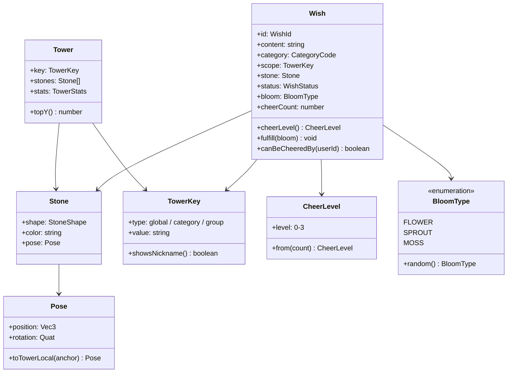
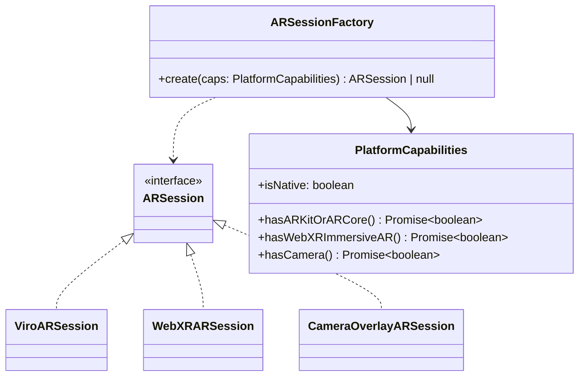

# 클라이언트 아키텍처 설계 (객체지향)

> 근거: [[기술 스택]], [[데이터 모델]], [[API 명세서]]
> 목적: AR 구현체 3개(Viro / WebXR / 간이 AR)와 3D·물리·인증 같은 플랫폼 차이를 **인터페이스 뒤로 숨겨서**, 화면과 비즈니스 로직은 플랫폼을 모르게 만든다.

## 1. 원칙

- **계층 분리:** `presentation`(화면·컴포넌트) → `application`(유스케이스) → `domain`(엔티티·규칙) ← `infrastructure`(Spring Cloud Gateway REST 어댑터, AR, 물리 구현체)
- **의존성 역전(DIP):** domain과 application은 인터페이스(포트)만 안다. 구현체(어댑터)는 `infrastructure`에 두고, 앱이 시작될 때 `container.ts`에서 주입한다.
- **플랫폼 분기는 한 곳에서만:** `PlatformCapabilities`가 판별하고, 팩토리가 구현체를 고른다. 화면 코드에 `Platform.OS` 분기를 두지 않는다.
- **파일 확장자 분기:** 네이티브와 웹 구현이 다르면 Expo의 `.native.ts` / `.web.ts` 규칙을 쓴다.

## 2. 폴더 구조 (초안)

```
src/
├─ app/                      # expo-router 라우트 (화면 설계서의 경로)
├─ presentation/
│  ├─ components/            # TowerCanvas, WishCard, CheerButton ...
│  └─ hooks/                 # useTower, useRandomWishes ... (유스케이스 호출)
├─ application/
│  └─ usecases/              # StackStoneUseCase, CheerWishUseCase ...
├─ domain/
│  ├─ entities/              # Wish, Stone, Tower, Group, User
│  ├─ value-objects/         # Pose, CheerLevel, BloomType, TowerKey, Nickname
│  └─ ports/                 # 인터페이스: Repository, ARSession, PhysicsWorld, AuthService ...
├─ infrastructure/
│  ├─ api/                   # Spring Cloud Gateway (:8080) 연동 어댑터 (MsaWishRepository 등)
│  ├─ auth/                  # MsaAuthService (Apple/Kakao/Google/Guest + JWT)
│  ├─ ar/
│  │  ├─ viro/               # ViroARSession (.native)
│  │  ├─ webxr/              # WebXRARSession (.web)
│  │  └─ overlay/            # CameraOverlayARSession (.web 대체)
│  ├─ physics/               # CannonPhysicsWorld, ViroPhysicsWorld
│  └─ platform/              # PlatformCapabilities
└─ container.ts              # 의존성 주입 (구현체 선택)
```

## 3. 도메인 모델



규칙은 엔티티 안에 둔다. 예: `Wish.fulfill()`은 이미 이루어진 소원이면 에러를 낸다. `CheerLevel.from()`이 단계 구간을 결정한다. `TowerKey.showsNickname()`은 그룹일 때만 true다.

## 4. 포트(인터페이스)

```ts
// domain/ports/ARSession.ts
export interface ARSession {
  readonly kind: 'viro' | 'webxr' | 'overlay';
  readonly supportsPlaneDetection: boolean;
  start(): Promise<void>;
  onPlaneFound(cb: (anchor: Pose) => void): Unsubscribe;
  placeTower(tower: Tower, anchor: Pose): void;
  beginDrag(stone: Stone): DragHandle;      // 드래그 → 놓기 → 물리 안착
  capture(): Promise<CapturedImage>;         // 사진 촬영
  stop(): Promise<void>;
}

// domain/ports/PhysicsWorld.ts
export interface PhysicsWorld {
  addStatic(stones: Stone[]): void;
  drop(stone: Stone, from: Pose): Promise<DropResult>; // { settled: boolean, pose: Pose }
  dispose(): void;
}

// domain/ports/AuthService.ts
export type AuthProvider = 'apple' | 'kakao' | 'google' | 'guest';
export interface AuthService {
  signIn(provider: AuthProvider): Promise<Session>;
  linkGuestTo(provider: Exclude<AuthProvider, 'guest'>): Promise<Session>;
  signOut(): Promise<void>;
  currentUser(): User | null;
}

// domain/ports/repositories.ts
export interface WishRepository {
  create(input: NewWish): Promise<WishId>;
  random(count: number, excludeIds: WishId[]): Promise<Wish[]>;
  mine(filter?: WishStatus): Promise<Wish[]>;
  cheer(id: WishId): Promise<{ level: CheerLevel; levelUp: boolean }>;
  report(id: WishId, reason: ReportReason): Promise<void>;
  fulfill(id: WishId, bloom?: BloomType): Promise<BloomType>;
  remove(id: WishId): Promise<void>;
}
export interface TowerRepository { get(key: TowerKey, limit?: number): Promise<Tower>; }
export interface GroupRepository { create(name: string): Promise<Group>; join(code: string): Promise<Group>; mine(): Promise<Group[]>; leave(id: GroupId): Promise<void>; }
export interface SeenWishStore { recent(): WishId[]; add(ids: WishId[]): void; } // 기기 로컬 저장, 최근 100개
```

## 5. AR 구현체 선택 (팩토리 + 전략 패턴)



선택 순서: 네이티브이고 ARKit/ARCore가 있으면 Viro → 웹이고 WebXR이 있으면 WebXR → 카메라가 있으면 간이 AR → 아무것도 없으면 `null`(일반 3D 모드, AR 메뉴 숨김).

## 6. 유스케이스 예시

```ts
// application/usecases/StackStoneUseCase.ts
export class StackStoneUseCase {
  constructor(private wishes: WishRepository, private physics: PhysicsWorld) {}

  async execute(draft: WishDraft, tower: Tower, dropFrom: Pose, attempt: number) {
    const result = await this.physics.drop(draft.stone, dropFrom);
    if (!result.settled && attempt < 3) return { status: 'retry' as const };
    const pose = result.settled ? result.pose : Pose.onTop(tower); // 3회 실패 시 자동 안착
    const id = await this.wishes.create({ ...draft, stone: { ...draft.stone, pose } });
    return { status: 'saved' as const, id };
  }
}
```

그 밖의 유스케이스: `CheerWishUseCase`(자기 소원 검사 → 저장 → 연출 이벤트 발행), `FulfillWishUseCase`, `BrowseRandomWishesUseCase`(SeenWishStore 연동), `JoinGroupUseCase`, `SignInUseCase`, `LinkGuestAccountUseCase`.

## 7. 연출(이펙트) 분리

화면 연출(응원 불꽃, 연출용 돌, 단계 상승 빛, 이루어짐 피어남)은 `EffectBus`(옵저버 패턴)로 발행·구독한다. 유스케이스는 `effects.emit({ type: 'cheered', wishId, levelUp })`만 부르고, 3D 캔버스 컴포넌트가 구독해서 재생한다. 그래서 연출을 바꿔도 로직은 그대로 둘 수 있다.

## 8. 테스트 전략

- domain과 application은 순수 TypeScript라 Jest로 단위 테스트를 한다. 포트는 가짜 구현(InMemoryWishRepository, FakePhysicsWorld)으로 바꿔 끼운다.
- infrastructure는 Supabase 로컬(`supabase start`)로 통합 테스트를 한다.
- AR 구현체는 실제 기기로 수동 테스트한다(PoC 체크리스트 = [[기술 스택]] 5장).

