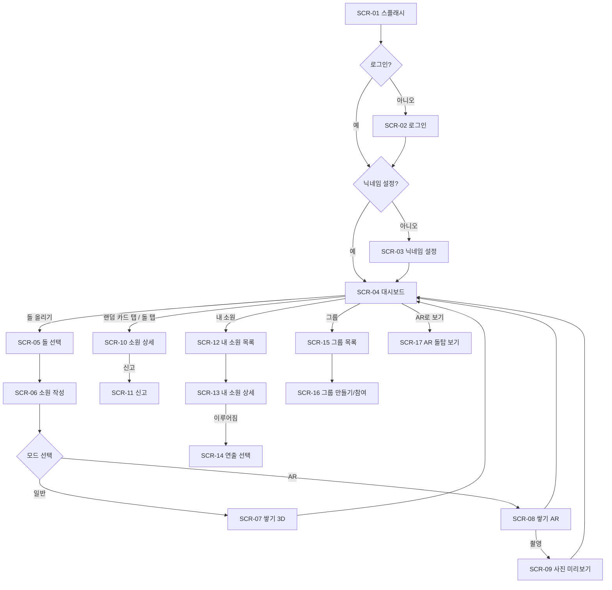

# 화면 설계서

> 근거: [[요구 사항 정의서]], [[API 명세서]] / 대상: 일반 사용자
> 레이아웃 기준: 모바일 세로 화면. 웹은 같은 화면을 중앙 정렬(최대 너비 480px)로 보여주고, PC에서는 돌탑 영역만 넓게 쓴다.

## 1. 화면 목록

| ID | 화면 | 경로 (expo-router) | 관련 요구사항 |
| --- | --- | --- | --- |
| SCR-01 | 스플래시 | `/` | DB-001 |
| SCR-02 | 로그인 | `/login` | DB-001 |
| SCR-03 | 닉네임 설정 | `/onboarding/nickname` | DB-001 |
| SCR-04 | 대시보드(홈) | `/home` | DB-002~007, 014~017, 022 |
| SCR-05 | 돌 선택 | `/stack/stone` | DB-008 |
| SCR-06 | 소원 작성 | `/stack/write` | DB-009 |
| SCR-07 | 쌓기 (일반 3D) | `/stack/place` | DB-010 |
| SCR-08 | 쌓기 (AR) | `/stack/ar` | DB-011, 012, 027~029 |
| SCR-09 | 사진 미리보기·공유 | `/stack/photo` | DB-013 |
| SCR-10 | 소원 상세 (타인) | 모달 | DB-014, 016, 018 |
| SCR-11 | 신고 | 바텀시트 | DB-018 |
| SCR-12 | 내 소원 목록 | `/me/wishes` | DB-019, 022 |
| SCR-13 | 내 소원 상세 | `/me/wishes/[id]` | DB-020, 021 |
| SCR-14 | 이루어짐 연출 선택 | 바텀시트 | DB-020 |
| SCR-15 | 그룹 목록 | `/groups` | DB-005 |
| SCR-16 | 그룹 만들기 / 참여 | `/groups/new`, `/join/[code]` | DB-005 |
| SCR-17 | AR 돌탑 보기 | `/tower/ar` | DB-011, 013 |
| SCR-18 | 설정 | `/settings` | - |

## 2. 화면 흐름



## 3. SCR-04 대시보드(홈) 상세

```
┌─────────────────────────────┐
│ StoneWish        [그룹][내소원]│  ← 상단 바
│ [전체][취업][학업][건강]…[그룹▾]│  ← ① 돌탑 전환 탭
├─────────────────────────────┤
│  돌 1,234 · 오늘 56 · 🌱 78    │  ← ② 통계 바
│                             │
│          ◯                  │
│        ◯ ◯ ◯                │  ← ③ 3D 돌탑 (회전·확대 가능)
│      ◯ ◯ ◯ ◯ ◯     [AR로 보기]│
│    ◯ ◯ ◯ ◯ ◯ ◯ ◯            │
├─────────────────────────────┤
│ ┌─────────────────────────┐ │
│ │ "올해는 꼭 합격하게 해주세요"│ │  ← ④ 랜덤 소원 카드 (좌우 스와이프)
│ │ #취업          🔥 응원  ⋯ │ │
│ └─────────────────────────┘ │
│  🔥 내 소원에 새 응원 3개      │  ← ⑤ 응원 소식 (있을 때만)
│           [ 🪨 돌 올리기 ]     │  ← ⑥ 메인 버튼
└─────────────────────────────┘
```

| 번호 | 요소 | 동작 | 데이터 |
| --- | --- | --- | --- |
| ① | 돌탑 전환 탭 | 전체 / 카테고리별 / 그룹(드롭다운) 전환. 마지막으로 본 탭을 기억한다. | API-14, 16 |
| ② | 통계 바 | 총 돌 수, 오늘 돌 수, 이루어진 소원 수 | API-04 |
| ③ | 3D 돌탑 | 드래그로 회전, 핀치로 확대. 돌을 탭하면 SCR-10을 연다. 내 돌은 테두리로 강조하고, 이루어진 돌은 꽃/새싹/이끼, 응원 단계에 따라 빛을 표시한다. 그룹 탭에서는 돌을 탭하면 닉네임이 보인다. | API-03 |
| ③-1 | AR로 보기 | AR 지원 환경에서만 표시하고, SCR-17로 이동한다. | - |
| ④ | 랜덤 소원 카드 | 스와이프하면 다음 카드로 넘어간다(5장씩 미리 받아둠). 🔥를 누르면 응원 연출(DB-017)이 나오고 버튼이 비활성화된다. ⋯를 누르면 신고 바텀시트가 뜬다. | API-06, 07 |
| ⑤ | 응원 소식 | 탭하면 SCR-12로 이동한다. | API-09 |
| ⑥ | 돌 올리기 | SCR-05로 이동한다. | - |

**응원 연출 순서 (DB-017)**
1. 🔥 버튼에서 불꽃 파티클이 튄다(0.5초).
2. 작은 돌 하나가 돌탑 꼭대기로 날아가 안착한다(0.8초). 저장하지 않는 연출용 돌이고, 새로고침하면 사라진다.
3. 응답에 `level_up`이 있으면 카드 속 돌이 빛나는 단계 상승 효과를 보여준다.

## 4. SCR-08 쌓기 (AR) 상세

```
┌─────────────────────────────┐
│ [✕]              [💡도움말]  │
│                             │
│   (카메라 화면)               │
│        ◯                    │
│      ◯ ◯ ◯   ← 바닥 위 돌탑   │
│   ─────────                 │
│                             │
│  "바닥을 비춰주세요"            │  ← 상태 안내
│                             │
│   [ 내 돌 🪨 ]   ← 드래그 시작점 │
│        [📷]   [완료]          │
└─────────────────────────────┘
```

| 단계 | 화면 상태 | 처리 |
| --- | --- | --- |
| 1. 권한 | 카메라 권한 요청 | 거부하면 안내 후 SCR-07(일반 모드)로 이동한다(DB-029). |
| 2. 바닥 인식 | "바닥을 비춰주세요" + 스캔 애니메이션 | 바닥이 인식되면 탭한 위치에 돌탑을 배치한다(최근 50개 돌만). 간이 AR이면 이 단계를 건너뛰고 화면 하단에 고정한다. |
| 3. 드래그 | 내 돌을 손가락으로 끌어 올림 | 손을 떼면 물리 시뮬레이션을 시작한다. |
| 4. 안착 판정 | 돌이 멈출 때까지 대기(최대 3초) | 탑 위에 안착하면 성공 연출. 바닥으로 떨어지면 "다시 올려볼까요?"를 띄우고 3단계로 돌아간다. 3번 실패하면 자동으로 꼭대기에 올려준다. |
| 5. 저장 | [완료] 활성화 | 탑 기준 로컬 pose로 바꿔 API-05를 호출한다. |
| 6. 촬영 (선택) | [📷] | 돌탑이 함께 보이는 사진을 찍어 SCR-09로 이동한다. 저장 전이나 후 언제든 찍을 수 있다. |

## 5. 기타 화면 요약

- **SCR-03 닉네임 설정:** 입력창(2~12자), 실시간 유효성 검사, "닉네임은 그룹 친구에게만 보여요"라는 안내 문구.
- **SCR-05 돌 선택:** 돌 모양·색상을 가로 스크롤로 보여주고, 선택한 돌을 3D로 미리 보여준다.
- **SCR-06 소원 작성:** 텍스트 입력(글자 수 카운터), 카테고리 칩, 올릴 돌탑 선택(전체 / 내 그룹들), [일반으로 쌓기] / [AR로 쌓기] 버튼(AR 미지원이면 일반만).
- **SCR-07 쌓기 (일반 3D):** 3D 돌탑 위로 돌을 드래그해 놓거나 [자동으로 올리기]를 누르고, 올라가는 애니메이션을 보여준 뒤 대시보드로 돌아간다.
- **SCR-09 사진 미리보기:** [저장] [공유] [다시 찍기]. 공유 시 소원 글 노출 여부와 워터마크는 협의 사항이다.
- **SCR-10 소원 상세:** 돌 3D 미리보기, 소원 본문, 카테고리, 응원 버튼, ⋯(신고). 그룹 소원이면 닉네임도 보여준다.
- **SCR-12 내 소원 목록:** 필터(전체 / 진행 중 / 이루어짐), 항목마다 돌 썸네일, 본문 일부, 응원 수, 새 응원 배지.
- **SCR-13 내 소원 상세:** [소원 이루어짐] 버튼을 누르면 SCR-14가 뜨고, ⋯ 메뉴에서 삭제할 수 있다.
- **SCR-14 연출 선택:** [🎲 랜덤(기본)] [🌸 꽃] [🌱 새싹] [🍀 이끼] 중 고르면 피어나는 연출을 재생한다.
- **SCR-15/16 그룹:** 그룹 목록(인원, 돌 수), 만들기(이름 입력 → 초대 코드·링크 공유), 코드 입력 또는 링크로 참여.

